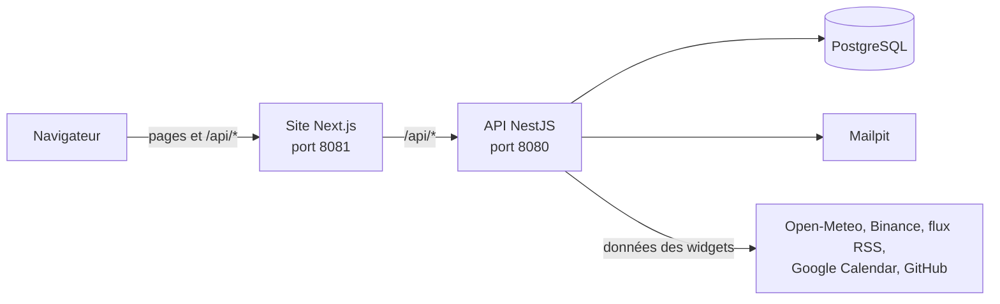
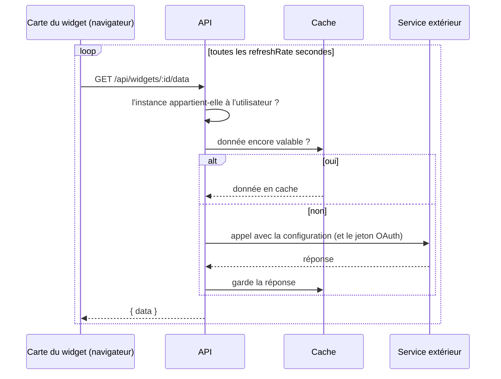

# Dashboard

Un tableau de bord personnel. Chaque utilisateur choisit des **widgets** (météo d'une ville,
cours d'une cryptomonnaie, derniers articles d'un flux RSS, prochains rendez-vous de son
agenda, derniers commits d'un dépôt GitHub…), les règle comme il veut et les dispose sur une grille. Chaque widget se met à jour
tout seul, à la fréquence choisie.

Projet Epitech G-WEB-500 « Dashboard ».

## Sommaire

- [Présentation](#présentation)
- [Fonctionnalités](#fonctionnalités)
- [Services et widgets](#services-et-widgets)
- [Installation et lancement](#installation-et-lancement)
- [Utilisation](#utilisation)
- [Développement](#développement)
- [Technologies et choix](#technologies-et-choix)
- [Architecture](#architecture)

## Présentation

Le dashboard rassemble sur une seule page des informations qui viennent de plusieurs
sites. Les cas d'usage principaux :

- **le point du matin** : la météo de sa ville, les rendez-vous du jour et les titres de
  l'actualité, sans ouvrir trois applications ;
- **le suivi d'un marché** : le cours d'une paire (par exemple BTC/EUR) et son historique
  sur 30 jours ;
- **la veille** : les derniers articles de plusieurs flux RSS, mis à jour automatiquement ;
- **le suivi d'un projet** : les derniers commits, les issues et les pull requests ouvertes
  d'un dépôt GitHub.

Les mots utilisés dans ce document :

| Mot | Sens |
|---|---|
| **Service** | une source de données : Météo, RSS, Marchés crypto, Google Agenda, GitHub |
| **Widget** | un bloc du dashboard qui affiche une donnée d'un service. Un service fournit plusieurs widgets |
| **Instance** | un widget ajouté par un utilisateur, avec ses propres réglages. On peut avoir deux widgets « Température » pour deux villes différentes |
| **Fréquence de rafraîchissement** | le nombre de secondes entre deux mises à jour d'un widget |

## Fonctionnalités

**Comptes**

- Inscription par email et mot de passe, avec un email de confirmation.
- Connexion par email, ou avec un compte **GitHub** ou **Google** (OAuth).
- Liaison de plusieurs comptes au même utilisateur (page *Accounts*).
- Mot de passe oublié, modification du profil et du mot de passe.
- Administration : liste des utilisateurs et bannissement.

**Services**

- Les services sans compte (Météo, RSS, Marchés crypto) sont **disponibles par défaut**.
- Les services liés à un compte (Google Agenda, GitHub) se connectent en un clic :
  l'utilisateur autorise l'accès chez le fournisseur, puis revient abonné.
- Désabonnement d'un service, qui retire aussi ses widgets.

**Dashboard**

- Ajout d'un widget en 4 étapes : choisir le type, le configurer, choisir sa fréquence,
  confirmer. Un **aperçu** montre le widget avant de l'ajouter.
- Reconfiguration, déplacement par glisser-déposer et suppression d'un widget.
- **Rafraîchissement automatique** de chaque widget selon sa propre fréquence (le
  « Timer » du sujet), et bouton pour rafraîchir à la demande.
- Grille « bento » : les widgets ont trois tailles (petit, haut, grand) et s'emboîtent
  sans trou.
- Palette de commandes **Ctrl + K** (⌘K sur Mac) : ajouter un widget, aller à une page,
  rafraîchir tous les widgets, changer de thème.
- Thème clair et sombre, interface adaptée au mobile, contrastes et navigation au clavier
  conformes au niveau WCAG AA.

## Services et widgets

| Service | Compte nécessaire | Widget | Paramètres | Fréquence minimale |
|---|---|---|---|---|
| **Weather** (Open-Meteo) | non | City temperature : température actuelle d'une ville | `city` (string) | 60 s |
| | | Forecast : prévisions sur plusieurs jours | `city` (string), `days` (integer, 3 par défaut) | 300 s |
| **RSS** | non | Article list : derniers articles d'un flux | `url` (string), `limit` (integer, 5 par défaut) | 300 s |
| | | Latest article : le dernier article, avec son résumé | `url` (string) | 300 s |
| **Crypto markets** (Binance) | non | Pair price : prix actuel d'une paire et variation sur 24 h | `base` (string), `quote` (string, EUR par défaut) | 60 s |
| | | Price history : historique des prix de clôture | `base`, `quote` (string), `days` (integer, 30 par défaut) | 60 s |
| **Google Calendar** | oui (Google) | Upcoming events : prochains rendez-vous | `days` (integer, 7 par défaut) | 60 s |
| | | Today's events : rendez-vous du jour | `limit` (integer, 5 par défaut) | 60 s |
| **GitHub** | oui (GitHub) | Last commits : derniers commits d'un dépôt | `repo` (string, au format `owner/name`), `limit` (integer, 5 par défaut) | 120 s |
| | | Open issues : issues ouvertes, les plus récentes d'abord | `repo` (string), `limit` (integer, 5 par défaut) | 300 s |
| | | Open pull requests : pull requests ouvertes, les plus récentes d'abord | `repo` (string), `limit` (integer, 5 par défaut) | 300 s |

La liste à jour des services et de leurs widgets est publiée par l'API sur
`GET http://localhost:8080/about.json`, au format demandé par le sujet.

## Installation et lancement

### Prérequis

- [Docker](https://docs.docker.com/get-docker/) avec Docker Compose (version 2).
- Les ports **8080** (API), **8081** (site), **5432** (base de données), **8025** et
  **1025** (emails) libres sur la machine.

### Lancer le projet

```sh
git clone git@github.com:EpitechPGE3-2026/G-WEB-500-PAR-5-1-dashboard-10.git
cd G-WEB-500-PAR-5-1-dashboard-10
docker compose build
docker compose up
```

Ces deux commandes suffisent : chaque réglage a une valeur par défaut. Au premier
démarrage, l'API crée elle-même les tables de la base de données.

| Adresse | Contenu |
|---|---|
| http://localhost:8081 | le site |
| http://localhost:8080/about.json | la description du serveur et des services |
| http://localhost:8025 | **Mailpit** : la boîte de réception de test, où arrivent les emails de confirmation |

Pour tout arrêter : `Ctrl + C`, puis `docker compose down`. Les données sont gardées
pour le prochain lancement. `docker compose down -v` les efface.

### Sauvegarder et restaurer la base

Les commandes se lancent depuis le dossier du projet, pendant que `docker compose up`
tourne.

```sh
# Sauvegarde : écrit toute la base dans un fichier daté
docker compose exec -T db pg_dump -U dashboard --clean --if-exists dashboard > backup-$(date +%F).sql

# Restauration : remplace le contenu de la base par celui du fichier
docker compose exec -T db psql -U dashboard -d dashboard < backup-2026-10-09.sql
```

`--clean --if-exists` place dans le fichier l'ordre de supprimer chaque table avant de la
recréer : la restauration remet la base exactement dans l'état de la sauvegarde. Si
`POSTGRES_USER` ou `POSTGRES_DB` ont été changés dans `.env`, remplacer `dashboard` par ces
valeurs.

### Réglages facultatifs (`.env`)

Pour changer un réglage, copier le fichier d'exemple, le remplir, puis relancer
`docker compose up` :

```sh
cp .env.example .env
```

| Variable | Rôle |
|---|---|
| `AUTH_SECRET` | clé qui protège les sessions et chiffre les identifiants des services. **À définir** dès que le projet sort de la machine locale (`openssl rand -base64 32`) |
| `ADMIN_EMAILS` | emails, séparés par des virgules, qui reçoivent le rôle administrateur |
| `GITHUB_CLIENT_ID`, `GITHUB_CLIENT_SECRET` | active la connexion avec GitHub et le service GitHub |
| `GOOGLE_CLIENT_ID`, `GOOGLE_CLIENT_SECRET` | active la connexion avec Google et le service Google Agenda |
| `API_PORT`, `WEB_PORT`, `DB_PORT`… | change un port déjà pris. Si `WEB_PORT` change, mettre `WEB_URL` au même port |

Sans clés GitHub ou Google, les boutons de connexion correspondants ne s'affichent pas :
le reste fonctionne.

**Créer les clés OAuth** (facultatif) : l'adresse de retour à déclarer chez le
fournisseur est `http://localhost:8081/api/auth/callback/github` pour GitHub et
`http://localhost:8081/api/auth/callback/google` pour Google. Pour Google Agenda, activer
aussi « Google Calendar API » dans la console Google Cloud et ajouter le scope
`calendar.readonly` à l'écran de consentement.

## Utilisation

1. **Créer un compte** sur http://localhost:8081/sign-up, puis cliquer sur le lien de
   l'email reçu dans Mailpit (http://localhost:8025).
2. **Ajouter un premier widget** : sur un dashboard vide, trois widgets sont proposés
   (météo de Paris, prix du Bitcoin, actualités). Un clic suffit.
3. **Ajouter d'autres widgets** avec le bouton *Add widget*, la case en pointillés en fin
   de grille, ou **Ctrl + K**. Le panneau montre le catalogue à gauche ; un clic sur un
   widget affiche son aperçu et son formulaire à droite.
4. **Régler un widget** avec l'icône de réglages de sa carte : paramètres et fréquence.
5. **Déplacer un widget** en le tenant par sa poignée (les 6 points) et en le lâchant sur
   un autre : les deux échangent leur place. Le lâcher sur la case *Add widget* l'envoie
   à la fin.
6. **Connecter Google Agenda ou GitHub** depuis la page *Services* ou depuis le panneau
   d'ajout : bouton *Connect*, autorisation chez le fournisseur, retour automatique.

## Développement

Pour travailler sur le code sans reconstruire les images Docker à chaque changement.

**Prérequis** : [Bun](https://bun.sh) 1.3 et Docker.

```sh
bun install
cp .env.example .env
./dev.sh
```

`dev.sh` démarre la base de données et Mailpit dans Docker, puis l'API et le site dans
deux panneaux `tmux`, avec rechargement automatique à chaque modification. Sans `tmux` :

```sh
docker compose up -d db mailpit
bun run dev:api
bun run dev:web
```

| Commande | Rôle |
|---|---|
| `bun run dev:seed` | crée des comptes de test **en local uniquement** (jamais lancé par Docker) |
| `bun run test` | lance les tests automatiques de l'API (Vitest) : règles des abonnements et des widgets, validation des paramètres, clients des API extérieures, authentification |
| `bun --filter api lint`, `bun --filter web lint` | vérifient le style du code |
| `bun --filter api db:generate` | génère une migration après une modification du schéma de la base |

## Technologies et choix

| Partie | Technologie | Pourquoi |
|---|---|---|
| Langage | **TypeScript** partout | un seul langage pour l'API et le site, et des types partagés : une erreur de format entre les deux est vue avant l'exécution |
| Gestion du projet | **Bun** (monorepo `apps/*`) | installe les dépendances et lance les scripts des deux applications depuis un seul dossier, plus vite que npm |
| API | **NestJS 12** | découpe le code en modules indépendants (authentification, services, widgets…) et gère l'injection de dépendances, ce qui rend chaque partie testable seule |
| Base de données | **PostgreSQL 17** | base relationnelle fiable ; les liens entre utilisateurs, abonnements et widgets s'y expriment avec des clés étrangères et des suppressions en cascade |
| Accès à la base | **Drizzle ORM** | écrit les requêtes en TypeScript, toujours paramétrées (pas d'injection SQL possible), et génère les migrations à partir du schéma |
| Validation | **Zod** | vérifie chaque donnée reçue par l'API, dont les paramètres `integer` et `string` des widgets |
| Authentification | **maison** (`apps/api/src/modules/auth/custom`) | tout le parcours (sessions, OAuth, rafraîchissement des jetons, bannissement) est maîtrisé et adapté au sujet, sans dépendre d'une bibliothèque externe |
| Site | **Next.js 16** (App Router) et **React 19** | le serveur prépare les pages avec les données de l'utilisateur, et le navigateur ne parle qu'à notre propre domaine |
| Interface | **Tailwind CSS 4** et **shadcn/ui** | des composants accessibles (clavier, lecteurs d'écran) dont le code est dans le projet et donc modifiable |
| Graphiques | **Recharts** (via le composant chart de shadcn) | l'historique des cours crypto |
| Glisser-déposer | **dnd-kit** | déplacement des widgets à la souris et au doigt |
| Emails | **Mailpit** | serveur d'emails de test : rien ne part vers de vraies adresses |
| Lancement | **Docker Compose** | une seule commande démarre les quatre parties, sur n'importe quelle machine |

## Architecture

### Vue d'ensemble



Le navigateur ne parle qu'au site. Le site transmet les appels `/api/*` à l'API. **Seule
l'API appelle les services extérieurs** : les jetons OAuth et les clés ne quittent jamais
le serveur.

### Arborescence

```
apps/
  api/                    API NestJS
    src/modules/
      auth/custom/        inscription, sessions, OAuth, mots de passe, limites de fréquence
      users/              profil et administration
      services/           registre des services, abonnements, jetons des comptes liés
        registry/         un dossier par service : weather, rss, crypto, google-calendar, github
      widgets/            instances de widgets, données, cache
      about/              GET /about.json
      mail/               envoi des emails
    drizzle/              migrations de la base
  web/                    site Next.js
    src/app/              pages (dashboard, services, comptes, connexion…)
    src/components/       composants : dashboard, widgets, panneau d'ajout, palette Ctrl+K
docker-compose.yml        base, Mailpit, API, site
```

### Le registre des services

Les services ne sont pas en base de données : ils sont **déclarés dans le code**, chacun
dans son dossier de `apps/api/src/modules/services/registry/`. Une déclaration donne le
nom du service, le type de compte nécessaire (`none`, `oauth` ou `credentials`) et ses
widgets, avec pour chacun :

- ses paramètres et leur type (`integer` ou `string`) ;
- sa fréquence par défaut et sa fréquence minimale ;
- la fonction `getWidgetData`, qui va chercher la donnée chez le service extérieur.

Ajouter un service, c'est ajouter un dossier et une ligne dans
`registry/services.ts`. La page *Services*, le catalogue du panneau d'ajout et
`/about.json` le montrent alors automatiquement.

### Le parcours d'une donnée (le Timer)



Chaque carte transmet sa fréquence à son propre minuteur, qui redemande la donnée à
l'intervalle choisi. Le cache de l'API évite d'appeler deux fois un service extérieur pour
la même configuration ; il est partagé entre utilisateurs pour les services sans compte,
et propre à chaque utilisateur pour les services liés à un compte.

### Les données

| Table | Contenu |
|---|---|
| `user`, `session`, `account`, `verification` | comptes, sessions, comptes liés (avec les jetons OAuth chiffrés), codes de vérification |
| `service_subscription` | abonnement d'un utilisateur à un service à compte, avec ses identifiants chiffrés |
| `widget_instance` | widgets de chaque utilisateur : service, widget, configuration, fréquence, position. Pour un service à compte, il est lié à l'abonnement et supprimé avec lui |

### Sécurité

- Mots de passe stockés **hachés** avec scrypt : personne ne peut les relire.
- Jetons OAuth et identifiants des services **chiffrés** (AES-256-GCM) en base.
- Requêtes toujours **paramétrées** par Drizzle : pas d'injection SQL.
- Chaque requête sur un widget ou un abonnement vérifie qu'il **appartient** à
  l'utilisateur connecté ; sinon l'API répond comme si l'objet n'existait pas.
- Les appels aux services extérieurs passent **par l'API** ; aucun secret n'est envoyé au
  navigateur.
- **Limite de fréquence** sur les routes d'authentification, des services et des widgets :
  au-delà, l'API répond `429 Too Many Requests`.
- Sauvegarde et restauration de la base testées (voir
  [Sauvegarder et restaurer la base](#sauvegarder-et-restaurer-la-base)).
- Le nom d'un dépôt GitHub est vérifié (`owner/name`) avant d'être placé dans une adresse,
  pour qu'il ne puisse pas viser une autre route de l'API GitHub.
- Le flux RSS est téléchargé avec une protection qui refuse les adresses internes
  (localhost, réseau privé), pour qu'un utilisateur ne puisse pas faire appeler par l'API
  une machine du réseau du serveur.
